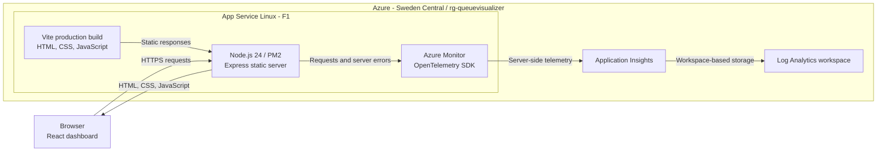

# Kaitajärven keskussairaala · Kuormitusmittari

An original Finnish-language dashboard for an **imaginary hospital**, in
[HVA-NextGen/queuevisualizer](https://github.com/HVA-NextGen/queuevisualizer).
Inspired by the purpose of the HUS congestion meter, without using its branding,
source code, or assets.

The hospital belongs to the fictional **Kaitajärven hyvinvointialue**, shown in
the header and footer.

**All counts, history, capacity, and thresholds are fictional. This is not
clinical information or care advice.** Data is fixed, not live.

## Architecture

The application is a single-page React frontend served by a small Node.js
static-file server. There is no data API, database, authentication service, or
connection to hospital systems.



### Application components

| Component | Responsibility |
|-----------|----------------|
| [React entry point](src/main.tsx) and [dashboard](src/App.tsx) | Render the Finnish hospital identity, patient counts, congestion status, and history. |
| [Demo fixture](src/data/demo.ts) | Hold and validate fixed patient counts and 24 hourly samples; format Helsinki timestamps. Data is bundled into the frontend, not fetched at runtime. |
| [Congestion rules](src/lib/congestion.ts) | Calculate capacity utilization and classify the fictional congestion levels. |
| [Gauge](src/components/CongestionGauge.tsx) and [bar chart](src/components/HistoryChart.tsx) | Render accessible SVG visualizations in the browser. |
| [Static server](server.mjs) | Serve the production build, apply response security headers, return real 404s, and report server errors. |
| [Server telemetry](telemetry.mjs) | Initialize OpenTelemetry before Express, record server exceptions, and flush on graceful shutdown. Disabled explicitly when no connection string is configured. |
| [Infrastructure](infra/main.bicep) | Define the F1 plan, Web App, publishing restrictions, Application Insights, workspace, and telemetry settings. |
| [Deployment wrapper](scripts/deploy.ps1) | Provision infrastructure and publish a source ZIP for the App Service build. |
| [GitHub Actions workflow](.github/workflows/deploy.yml) | Validate and deploy application code on `main` using passwordless Azure OIDC authentication. |

### Request and telemetry flow

1. A browser requests `/` over HTTPS. Express returns the built HTML and assets.
2. React runs in the browser using the bundled fixture. The gauge and 24-hour
   bars are calculated locally; there is no polling or live patient-data feed.
3. Server-side OpenTelemetry records incoming HTTP requests. Express error
   handlers also record exceptions; browser page views and JavaScript errors
   are not collected.
4. Telemetry is exported to Application Insights and stored in its linked
   Log Analytics workspace, separately from the dashboard's fictional data.

### Build and runtime boundaries

Vite and TypeScript are build tools, not production servers. App Service's
Oryx build restores npm dependencies and creates `dist/`; PM2 then runs the
Express adapter on the platform-provided port. The Application Insights
connection string is injected through App Service configuration and is not
included in browser assets.

## Local development

Use Node.js 24 LTS (for parity with Azure hosting) and npm.

```powershell
npm ci
npm run dev
```

Open the local URL printed by Vite.

```powershell
npm run lint
npm run typecheck
npm test
npm run build
npm run test:hosting
npm start
```

The production server serves the built site at `http://localhost:3000`.
To supply another port in PowerShell: `$env:PORT = '8080'; npm start`.
It requires a successful build and fails explicitly if the build or port is
invalid. Missing assets and unknown paths return 404, not the application's HTML.
There is one page at `/`; no client-side router or data backend is used.

## Demo rules

- 42 total patients, including 8 extremely urgent patients.
- Invented capacity: 60 patients, giving 70% occupancy.
- Below 40%: **Ei ruuhkaa**; 40% to below 75%: **Kohtalaista ruuhkaa**;
  75% and above: **Ruuhkautunut**.
- The displayed sample ends at **5.11.2026 at 20.00 Helsinki time**, not the
  current browser time. There are 24 hourly samples, ending at the same 70%.
- Occupancy above 100% is classified as high; only the gauge needle stops at
  the end of its scale.
- `src/data/demo.ts` holds and validates the typed fixture.
  `src/lib/congestion.ts` supplies shared calculation and classification.
- The history is a 24-bar hourly chart. Every hourly value is included in its
  screen-reader description and individual bar tooltip; there is no table
  toggle. Status is communicated with text, not color alone. No animation or
  automatic refresh is used.

## Azure App Service hosting

Live site: **https://app-queuevisualizer-dev-swedencentral-001.azurewebsites.net**

Hosted on **Azure App Service Linux F1 (Free), Node.js 24 LTS**, in
`rg-queuevisualizer`, Sweden Central. The F1 plan has daily CPU limits, cold
starts, and no SLA or Always On. Server request/error monitoring uses
workspace-based Application Insights and Log Analytics in the same resource
group and region. No database or browser tracking is configured.

Express serves the production files; Vite is not a production server.
HTTPS-only is enabled, FTP and basic publishing credentials are disabled,
and deployment uses Azure CLI authentication. No credentials are stored in
this repository.

### GitHub Actions deployment

[Deploy to Azure App Service](.github/workflows/deploy.yml) runs on pushes to
`main`. It can also be started from the repository's **Actions** tab using
**Run workflow** with `main` selected; other branches cannot deploy.

The workflow installs dependencies on Node.js 24, runs lint, dashboard tests,
the TypeScript/production build and hosting tests, then deploys source and
verifies the public HTTPS page. Deployments are serialized without cancelling
an active deployment.

Azure authentication uses OIDC, not a stored password or publish profile:

- Managed identity: `id-queuevisualizer-dev-swedencentral-001`.
- Federated issuer: `https://token.actions.githubusercontent.com`.
- Trusted subject:
  `repo:HVA-NextGen@319864792/queuevisualizer@1447344833:ref:refs/heads/main`.
  GitHub includes the organization and repository IDs in this token subject.
- Audience: `api://AzureADTokenExchange`.
- Role: **Website Contributor**, scoped only to
  `app-queuevisualizer-dev-swedencentral-001`.

The identity, federated credential and role assignment were configured once
in Azure. Repository **Actions variables** contain these non-secret identifiers:

| Variable | Value |
| --- | --- |
| `AZURE_CLIENT_ID` | `4bd03959-17f2-4464-8615-3785e6a99663` |
| `AZURE_TENANT_ID` | `e6eb6b36-75f8-4c32-94fc-953eff5c5c37` |
| `AZURE_SUBSCRIPTION_ID` | `aa8e5073-bda3-45ad-a772-7c5989954f8e` |

CI calls `scripts/deploy.ps1 -CodeOnly`: it publishes to the existing Web App
without reading or provisioning resource-group infrastructure. It cannot change
the App Service plan, monitoring resources, identity or role assignments.
Infrastructure changes still require the manual deployment below with an
appropriately authorized Azure account. The one-time CI identity configuration
is separate from `infra/main.bicep`.

### Manual infrastructure and application deployment

The infrastructure is defined in `infra/main.bicep`; parameters are in
`infra/main.parameters.json`. The deployment wrapper checks existing targets,
provisions the template, packages source, and deploys it:

```powershell
npm ci
npm run lint
npm test
npm run build
npm run test:hosting
az login
.\scripts\deploy.ps1
```

The wrapper targets the approved subscription and resource group by default.
Review its parameters before deploying elsewhere. It refuses to modify an
existing non-F1/non-Linux plan or move an existing app to a different plan.
Do not upgrade hosting without cost approval.

The source ZIP has project files at its root, excludes local dependencies,
Git metadata and secrets, and is generated under ignored `.azure/artifacts/`.
App Service build automation (`SCM_DO_BUILD_DURING_DEPLOYMENT=true`) restores
dependencies and runs `npm run build`. Retain devDependencies for TypeScript
and Vite during that build; Express remains a production dependency.

The startup command is
`pm2 start server.mjs --node-args="--import=@azure/monitor-opentelemetry/loader" --no-daemon`;
the server binds to
`0.0.0.0` and honors App Service's `PORT`. No client-side router is used.

After deploying, check the HTTPS root, referenced JavaScript/CSS, missing-asset
404 responses and actual browser UI. Inspect deployment logs with
`az webapp log deployment show --resource-group rg-queuevisualizer --name app-queuevisualizer-dev-swedencentral-001`.
Future client routes require an intentional SPA fallback that preserves asset
404 responses.

### Server monitoring

- Application Insights: `appi-queuevisualizer-dev-swedencentral-001`.
- Log Analytics: `log-queuevisualizer-dev-swedencentral-001`.
- The workspace uses consumption pricing, 30-day retention, and a 0.1 GB daily
  ingestion cap. The cap is not a guaranteed spending ceiling; ingestion may
  overshoot and other applicable monitoring charges can remain.
- The connection string is supplied through the Web App's
  `APPLICATIONINSIGHTS_CONNECTION_STRING` setting, not stored in source.
- The Azure Monitor OpenTelemetry SDK initializes before Express. The ESM loader
  is enabled in both `npm start` and the App Service startup command.
- Incoming requests are instrumented; server error handlers record exceptions.
  Telemetry is flushed during graceful shutdown. No synthetic error endpoint or
  browser SDK is exposed. Standard/live metrics are disabled to reduce volume.
- Local runs without a connection string explicitly report telemetry disabled.
- In the Application Insights Logs blade, query
  `requests | where timestamp > ago(30m) | summarize count() by resultCode`.
  Exceptions appear in `exceptions`. In workspace Logs, the equivalent tables
  are `AppRequests` and `AppExceptions`. Ingestion may take several minutes.

Reference:
[Configure Node.js apps in Azure App Service](https://learn.microsoft.com/en-us/azure/app-service/configure-language-nodejs).
